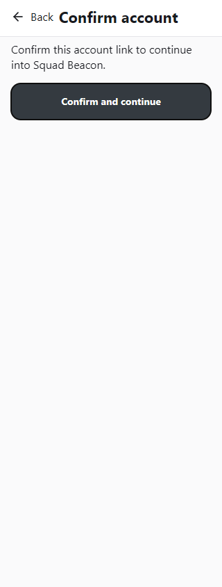
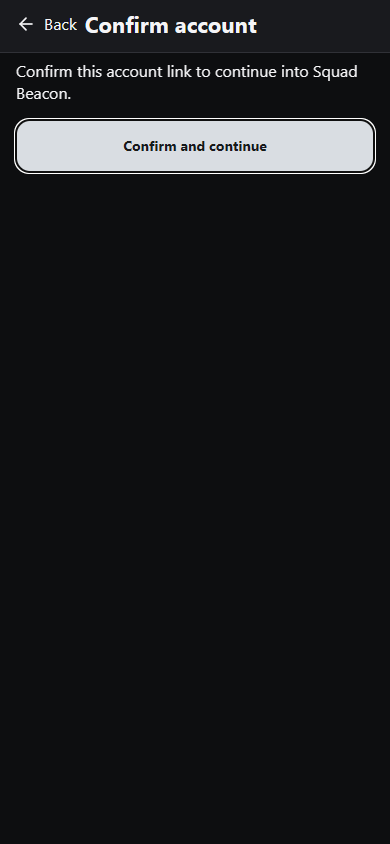
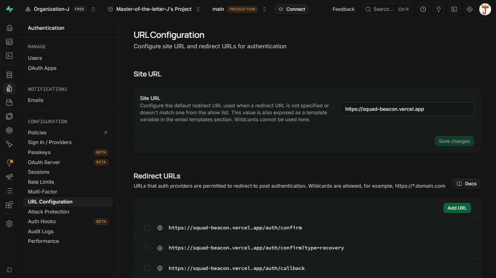
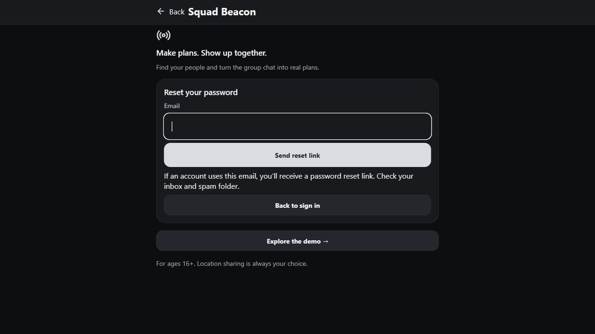

# Reliable Account Email Links — 2026-10-29

The auth-only release is live at https://squad-beacon.vercel.app. The public origin, hosted Site URL and callback allowlist are configured. A live recovery request was accepted and the owner confirmed email arrival. The owner explicitly chose to retain Supabase's default sender; custom token-hash templates are prepared but intentionally unapplied. This does not establish full production readiness or different-browser recovery acceptance. Canonical setup and domain-change instructions live in [README.md](../README.md#account-email-configuration).

## Delivered

- `src/features/auth/accountEntry.ts` validates the public HTTPS origin before signup, recovery or resend can send email. Local `.env` is configured; `.env.example` contains the public setting. Sign-in remains available without email configuration.
- `app/auth/confirm.tsx` and `AuthCallback.tsx` present an explicit confirmation action. Loading the page does not exchange its token. `authLink.ts` supports `email`, legacy `signup`, recovery and PKCE; an in-memory operation survives account-provider remounts without another exchange.
- `ResendAuthEmail.tsx` uses existing Supabase signup resend/recovery services, immediate submission locking and neutral results. It never creates an account.
- Existing required-profile readiness, optional personalization, invitation consent, session ownership and account-progress isolation remain in place. Successful continuation replaces the credential-bearing address.
- `vercel.json` adds auth-only no-store/no-referrer headers and serves matching exported auth HTML before the existing catch-all. Guest routing from concurrent work is preserved. The preview server mirrors those headers; confirmation HTML also includes a no-referrer meta tag.
- `supabase/templates/confirmation.html` and `recovery.html` are ready to copy into hosted Auth templates when editing is enabled. They use Site URL and token hashes, with separate email/recovery types. They have not been applied remotely: the Free dashboard requires custom SMTP or a Pro upgrade, and the owner chose to keep the default sender.
- No database migration, dependency, session-storage redesign or native association files were added for this work.

## Validation boundaries

- Focused local onboarding/unit/database suite: 25 passed, including required-profile readiness and canonical email origin/link validation. Database evidence uses local PGlite, not hosted Supabase.
- Initial focused browser run: 8 passed using intercepted Supabase requests. The expanded run also passed a simulated HTTPS preview-host test: signup/resend still target the configured public origin. Confirmed no request on page load, one exchange through provider remount, fresh-browser required setup, recovery separation, invalid/expired links and resend throttling.
- Development and production Expo web exports succeeded and include `/auth/confirm` and `/auth/callback` HTML.
- Broader browser regression: 38 passed, 1 failed. All 23 existing account-entry journeys and all 9 email-link journeys passed. The failing Phase 4A demo scenario expects Home's `View invitations & responses` button; concurrent changes in `ActivitiesScreen.tsx` remove that button. The email work does not modify that screen. Six other Phase 4A journeys passed, including dismissal, account progress/failure, confirmed success and phone compositions. Failure evidence is in `test-results/auth-email`.
- Final email-link/layout run after the heading refinement: 13 passed (9 functional journeys and 4 layout cases). The layout cases cover 320px/390px in light/dark, keyboard focus, at least 44px button height, no horizontal overflow and reduced motion. Screenshots are under `docs/screenshots/auth-email/`; the small-screen heading was shortened after visual review. Evidence is in `test-results/auth-email-final`.
- `npm run typecheck` and `npm run lint` passed. The first slow lint invocation was interrupted; the final complete lint run passed with no warnings. Both final Expo exports succeeded.
- The actual release was separately prepared from production commit `30498385` plus only the ten auth/config/template files in release commit `c2186c085ab3ba06fdfdbb533c6a15f66e9ee8b2`. Its own typecheck and production export passed, followed by all 36 browser checks (23 account-entry journeys, 9 email-link journeys and 4 layout checks). Evidence is in `test-results/auth-email-release` and `test-results/auth-email-release-account`. The initial standalone typecheck needed Expo's generated web declaration file; including that existing generated declaration resolved the CSS import declaration error.
- Browser fixtures do not send real email or validate delivery, hosted template settings, redirect allowlists, or SMTP. Legacy PKCE verification across browsers still requires the original verifier; new token-hash email templates avoid that requirement.

## Hosted rollout and remaining acceptance

Vercel team access was authorized. `EXPO_PUBLIC_AUTH_ORIGIN=https://squad-beacon.vercel.app` is saved for Production, Preview and Development. Deployment `dpl_GWWUCJLPjTQuKxvuzR4hPVxwXYTN` is READY, target Production, using commit `c2186c08` on `codex/reliable-account-email-links`; its build took about four minutes. The canonical public domain is assigned to it. Previous production deployment `dpl_EhytgRAApvKRfsgSsnZXBa6JCqbV` remains available as a rollback candidate. A redundant automatic preview of the same release was canceled to free the build slot. The shared checkout and staging area were preserved on master; concurrent guest/UI changes were excluded from release.

Through the signed-in Supabase dashboard, six exact website/legacy-app callback URLs were added first. After the compatible production routes were live, hosted Site URL was changed from `http://localhost:3000` to `https://squad-beacon.vercel.app`. Custom SMTP remains disabled, and email templates remain the service defaults. No billing, sender/provider, password, database or user-profile changes were made.

Live checks: `/auth/confirm`, `/auth/callback` and `/activities` return HTTP 200. Both auth routes return `Cache-Control: no-store` and `Referrer-Policy: no-referrer`. The deployed confirmation screen handles a missing token safely. The live recovery form accepted one request to the owner's authorized existing account; the owner confirmed email arrival. Its password was not changed, and an actual recovery exchange/password replacement was not performed. A new hosted signup was not created because the supplied account already exists and is confirmed. Runtime error/fatal log counts for the new deployment returned no entries; this static-site check does not establish Supabase or device health.

Default email links still verify at Supabase before redirecting and retain PKCE's original-tab verifier requirement. Direct token-hash links use the explicit confirmation page, but the default hosted templates do not produce those links yet. Therefore do not claim default-email prefetch protection or automatic different-browser sessions. Full token-hash email acceptance is deferred with the sender/template decision. Default SMTP also restricts recipients to project-team addresses and has a low sending limit. Replace previously sent localhost links with fresh emails; old links are not repaired by changing Site URL.

Native builds must embed the configured public origin. Installed-app opening requires verified iOS/Android signing identities and domain-association files; until then the HTTPS website is the destination. Native-device acceptance remains outstanding.

## Screenshots

